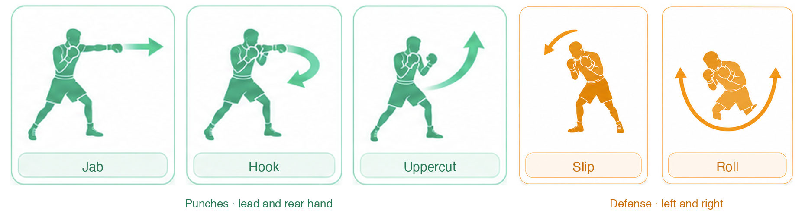
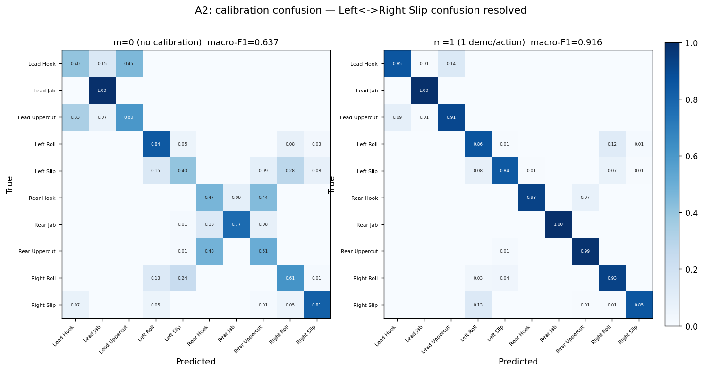
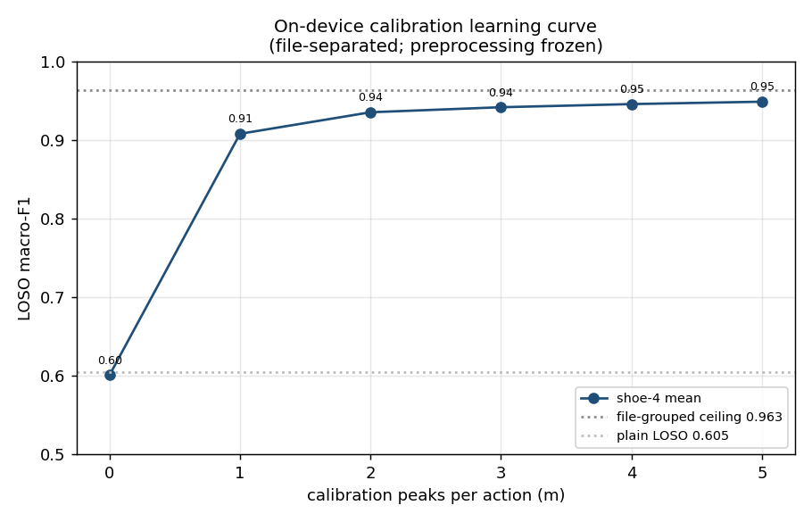
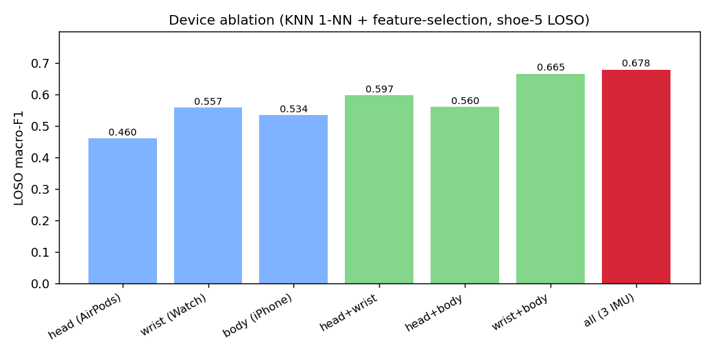
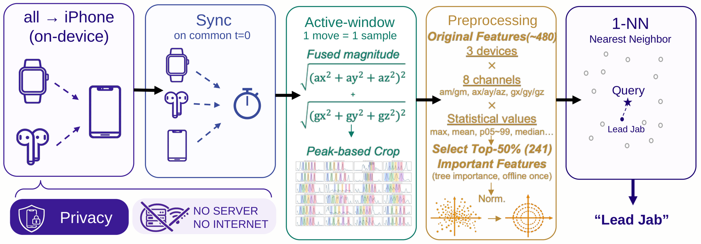

<p align="center">
  
</p>

<p align="center">
  <b>P</b>unch &amp; <b>H</b>ead <b>A</b>ction · <b>N</b>etworked <b>T</b>racking · <b>O</b>mni-device <b>M</b>otion sensing
</p>


PHANTOM tracks both offense and defense during shadowboxing with three devices you
already own: an Apple Watch on the lead wrist, an iPhone in the rear hand, and AirPods Pro
on the head. It recognizes six punches and four defensive head movements, runs entirely
on-device, and can be personalized in about a minute by demonstrating each action once.

Most boxing trackers only measure punches and need a bag. PHANTOM also tracks slips and
rolls and works anywhere.

## Highlights

- **10 actions:** Lead/Rear Jab, Hook and Uppercut, plus Left/Right Slip and Left/Right Roll.
  A `none` class and an idle filter reject non-boxing motion.
- **3-device fusion:** Watch, iPhone and AirPods IMU streams are time-aligned on the phone.
  All three together beat any single device or pair.
- **On-device and offline:** a 1-nearest-neighbour classifier runs on the iPhone. There is
  no server and no network call.
- **Few-shot personalization:** one demonstration per action lifts unseen-user macro-F1
  from 0.61 to 0.91. Calibration appends reference vectors to the KNN, so there is no
  on-device training.
- **Transition Time:** measures how fast the boxer switches from attacking to defending.

<br clear="right">

## Dataset



Five subjects recorded every action with all three devices. Each single-action recording
starts with a sync jump followed by 5 repetitions, and the fused IMU magnitude is cut into
one window per peak. Combination recordings (e.g. Lead Jab, Left Slip, Rear Hook) were
collected to test fast transitions. 1,251 windows in total. The raw data is not included
in this repository.

## Results

Evaluated on 5 subjects, 10 classes, macro-F1.

| Setting | Macro-F1 |
|---|---|
| Unseen person, leave-one-subject-out (LOSO) | 0.64 |
| Known person, file-grouped split (upper bound) | 0.96 |

Calibration is evaluated per held-out subject, with calibration and test recordings
taken from separate files:

| Calibration demos per action | 0 | 1 | 5 |
|---|---|---|---|
| Unseen-person macro-F1 | 0.61 | 0.91 | 0.95 |



Without calibration, most errors are hook vs. uppercut on the same hand and left vs. right
defenses. One demo per action removes most of them.

<p align="center">
  
  
</p>

**Device ablation (LOSO macro-F1):** head 0.46 · wrist 0.56 · hand 0.53 ·
head+wrist 0.60 · head+hand 0.56 · wrist+hand 0.67 · **all three 0.68**.

**Why 1-NN?** After calibration, an RBF SVM is slightly more accurate (0.93 vs 0.91), but
it must be fully retrained for every new sample. KNN calibration is a single vector
append (about 0.07 ms), which makes instant on-device personalization practical.

**Baseline.** We reproduced BoxerSense (Hanada et al., 2021) on our data with its
features, models and leave-one-person-out protocol. On their setting (one wrist IMU,
3 rear punches) the reproduction scores 0.61, versus 0.91 reported in the paper. Their
recordings use 4-second pauses between punches, while ours are continuous, so our task
is harder. See [`figures/boxersense_repro.png`](analysis/five_subject_active_window_classifier/figures/boxersense_repro.png).

**Limitations.** Five subjects, recorded on a single day each, so cross-day
generalization is untested. Calibration personalizes the model; it does not make the
base model generalize better.

## How it works



<details>
<summary>Pipeline as text</summary>

```
Apple Watch (lead wrist) ──WCSession──┐
iPhone      (rear hand)  ─────────────┼──> session-relative timeline on iPhone
AirPods Pro (head)       ─────────────┘
                                        │
                                        ▼
            motion envelope (40 ms bins, gyro + dynamic accel, smoothed)
                                        │
                              peak detection (≥ 0.5 s apart)
                                        │
                     active window around each peak (-0.5 s / +0.8 s)
                                        │
          ~490 per-device features -> impute -> variance filter
                    -> RobustScaler -> L2 normalize
                                        │
           1-NN (Manhattan) over the bundled reference + user calibration
                                        │
                     action label, or reject (idle / none)
```

</details>

The Python analysis pipeline trains and evaluates the model, then exports the reference
set to `iOS/Resources/knn_params.json`. `MotionRuleClassifier.swift` re-implements the
same preprocessing in Swift, and `phase5_verify.py` checks that the Swift arithmetic matches
sklearn. See [ARCHITECTURE.md](ARCHITECTURE.md) for the app internals.

## Repository layout

```
iOS/                 iPhone app (SwiftUI): session, calibration, history, data collection
Watch/               Apple Watch app: 100 Hz wrist IMU, HKWorkoutSession keep-alive
Shared/              Code compiled into both targets
analysis/
  common/            Segmentation and feature extraction shared with the app
  five_subject_active_window_classifier/
                     Inspection, segmentation, evaluation, model comparison,
                     calibration, combo experiments, model export, figures
docs/                Data collection protocol
project.yml          XcodeGen spec for BoxingTracker.xcodeproj
```

## Getting started

### App

Requirements: Xcode 15+, iOS 16+, watchOS 9+, an Apple Watch, and AirPods Pro or
AirPods Max (regular AirPods do not expose head motion).

1. Open `BoxingTracker.xcodeproj`, or regenerate it with `xcodegen generate`.
2. Set your own development team and bundle identifier for both targets
   (`BoxingTracker`, `BoxingTrackerWatch`).
3. Build and run the `BoxingTracker` scheme on a paired iPhone. The Watch app is
   embedded and installs automatically.

In the app:

- **Session:** start a session, shadowbox, stop. The recording is classified into a
  sequence of actions with Transition Time stats.
- **Calibrate** (from the Session tab): demonstrate each of the 10 actions once to
  personalize the model.
- **Reject:** demonstrate non-boxing motions you want ignored.
- **Raw Stream / Files:** record and export labeled 3-device IMU data.

### Analysis

```bash
python3 -m venv .venv && source .venv/bin/activate
pip install -r analysis/requirements.txt

python3 analysis/five_subject_active_window_classifier/phase0_inspect.py   # data QC
python3 analysis/five_subject_active_window_classifier/phase1_segment.py   # build dataset
python3 analysis/five_subject_active_window_classifier/evaluation.py       # LOSO evaluation
python3 analysis/five_subject_active_window_classifier/phase3_models.py    # model comparison
python3 analysis/five_subject_active_window_classifier/phase45_calibration.py
python3 analysis/five_subject_active_window_classifier/phase5_export.py    # -> knn_params.json
```

The raw dataset is not included in this repository. Scripts expect recordings under
`Data/<subject>_data/`. See [docs/DATA_COLLECTION.md](docs/DATA_COLLECTION.md) for the
recording protocol and file naming.

## Team

starTrack (UNIST): Kim Geonho, Park Jiho, Son Juho, Jeong Jiseung

## License

[MIT](LICENSE)
